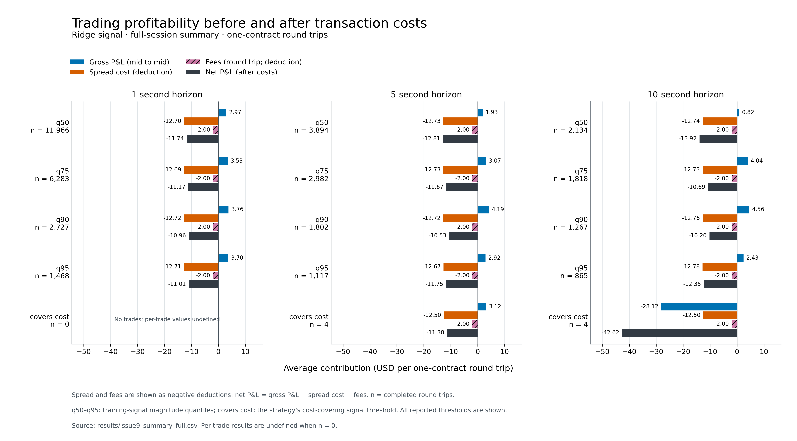
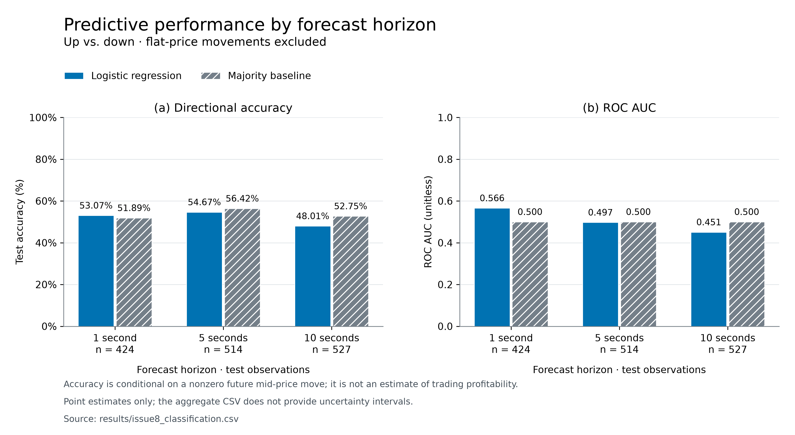

# Does ES order flow predict the next few seconds?

FINM 37000 Group 15: Arjun Patel, Jean-Luc Choiseul, Alexei Le.

## Result

Order flow in E-mini S&P 500 futures (ESZ6) carries a small, real signal about the next second of price movement, but it is too small to trade. Before costs the signal earns between $0.82 and $4.56 per trade, depending on horizon and threshold. Crossing the bid-ask spread costs about $12.70 per round trip (one tick), plus $2.00 in fees, so every threshold and horizon that traded lost money. It still loses money with zero fees: the least bad case loses $8.20 per trade.

Full 08:30 to 15:00 CT session of Sep 24, model trained on Sep 22 and 23, one position at a time, $1.00 fee per side, threshold q50:

| Horizon | Correlation of prediction with next move | Trades | Gross per trade | Spread cost per trade | Net per trade |
|---|---|---|---|---|---|
| 1s | 0.151 | 11,966 | $2.97 | $12.70 | -$11.74 |
| 5s | 0.055 | 3,894 | $1.93 | $12.73 | -$12.81 |
| 10s | 0.036 | 2,134 | $0.82 | $12.74 | -$13.92 |



The signal fades as the horizon grows, and predicted moves reach the 1.16 ticks needed to cover costs in at most 0.05% of seconds. Other thresholds and fee levels from $0 to $2.50 are in `results/issue9_summary_full.csv` and `results/issue9_cost_sensitivity_full.csv`.

## Classification check (first 10 minutes only)

Before simulating, we tested whether the features beat a majority-class baseline out of sample, using logistic regression on 08:30 to 08:40 CT of each day.



At 1 second, accuracy was 53.1% against 51.9% for the baseline. The 95% block-bootstrap interval for that 1.2-point gain, -6.6 to +8.1 points, includes zero. At 5 and 10 seconds the model did worse than the baseline (54.7% vs 56.4%, and 48.0% vs 52.8%). These figures leave out zero-tick moves (29% of 1-second test observations), so they measure direction given that the price moves, not achievable trading accuracy. Ten minutes is also too short to be conclusive: the 5 and 10 second correlations were negative on that window and are positive on the full session, which looks like small-sample noise.

## Data and method

Data is Databento's CME Globex feed (GLBX.MDP3, `mbp-1`: top of book plus trades) for ESZ6 on Sep 22 to 24, 2026, with 4.1, 5.6 and 6.8 million events per regular session. The loader (`src/orderflow/loader.py`) checks Databento's billable size before each download, cleans the book and caches parquet files under `data/cache/`, which git ignores. Cleaning dropped no rows.

Features are book size imbalance, 5-second signed aggressive volume and 5-second trade count on a 1-second grid. Labels are the forward mid-price change over 1, 5 and 10 seconds. Both are built separately for each session, so no window crosses a day boundary. Models train on Sep 22 and 23 and are tested on Sep 24, with no shuffling. The simulation buys at the ask when the Ridge prediction is above a threshold, sells at the bid when it is below the negative threshold, holds for the horizon, then exits by crossing the spread again. Thresholds come from training-day quantiles. Costs are the half-spread paid at entry and exit plus a fee per side.

## Limitations

There is one test day and two training days, so the results are indicative, not conclusive. The simulation assumes zero latency and a full one-lot fill at the top of book, which is optimistic. The t-statistics in the results files treat trades as independent and are overstated. The $1.00 fee is a placeholder, but the conclusion does not depend on it. The classification results use only 10 minutes per day. We did not test passive limit orders, which earn the spread instead of paying it but tend to fill just before the price moves against you. That is the natural next step, along with more days and a volatility-regime split.

## How to run

You need Python 3.12+, a Databento API key with CME access, and about 1.3 GB of downloads on the first run (331, 449 and 547 MB for Sep 22 to 24; each pull is capped at 2 GB).

```
git clone https://github.com/ArjunPatel624/finm37000-group15.git
cd finm37000-group15
pip install git+https://github.com/pattersonem/finm37000-autumn-2026
pip install -r requirements.txt
```

Save your Databento key on one line in `~/.databento_api_key`. Never commit it.

```
python scripts/run_issue8.py --allow-download     # classification and regression (10-minute window); downloads and caches the 3 sessions
python scripts/run_issue9.py                      # simulation, 10-minute window
python scripts/run_issue9.py --window-minutes 0   # simulation, full session (the headline results)
python scripts/run_issue9.py --center             # simulation with the training drift removed
python scripts/plot_final_results.py              # redraws results/figures/*.png from the saved CSVs; no download
python -m pytest -q                               # tests
```

`run_issue9.py` also accepts `--allow-download`. The simulation script always writes unsuffixed file names; the committed `*_full.csv` and `*_centered.csv` files were renamed by hand from those runs. The trading figure needs `results/issue9_summary_full.csv`.